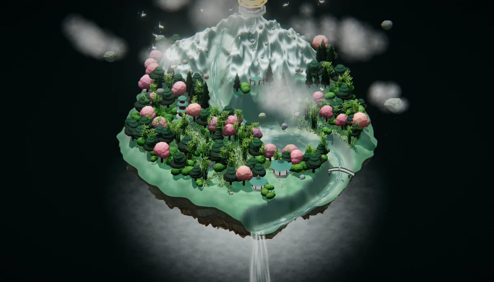

# 蓬莱 · 仙境

悬浮在深空玻璃立方体里的一座微缩仙山 —— 雪山、双瀑、蜿蜒河流、小湖、亭塔桥、
山门与仙人,全部程序化生成,**零贴图**。打成一个约 640 KB 的 `index.html`,双击即开。



## 打开

双击 `index.html` 即可(资源全内联,`file://` 也能跑,不联网)。或者:

```bash
python3 -m http.server 8189   # → http://127.0.0.1:8189/index.html
```

## 操作

| 按键 | 作用 |
|---|---|
| 拖动 / 滚轮 | 旋转视角 / 推近(正交等距,最多 4×) |
| `Space` | 暂停 / 继续昼夜与自转 |
| `G` | 玻璃立方体显隐 |
| `1` `2` `3` `4` `5` | 黎明 / 上午 / 午后 / 黄昏 / 夜 |
| `V` · `Esc` | 切到下一位仙人的眼睛 / 退出 |
| `F` `B` `A` `P` | 移轴 · Bloom · FXAA · 整条后处理链 |
| `H` · `R` | HUD 显隐 · 回到初始机位 |

仙人视角里还可以用方向键挪站位、`[` `]` 改眼高、`C` 把坐标打到控制台。

## 构建

```bash
npm install
npm run build        # → index.html(单文件,可分发)
```

## 许可

**MIT** —— 见 [LICENSE](LICENSE)。随便用、改、商用,保留版权声明即可。

内联的 three.js r169 同为 MIT,见 [vendor/three/LICENSE](vendor/three/LICENSE)。
除 three.js 外没有第三方素材:地形、植被、建筑、人物、贴图、天空全部由代码生成。

实现细节、验收脚本、已知取舍 → [docs/TECH.md](docs/TECH.md)

作者 [@puerr](https://github.com/puerr)
