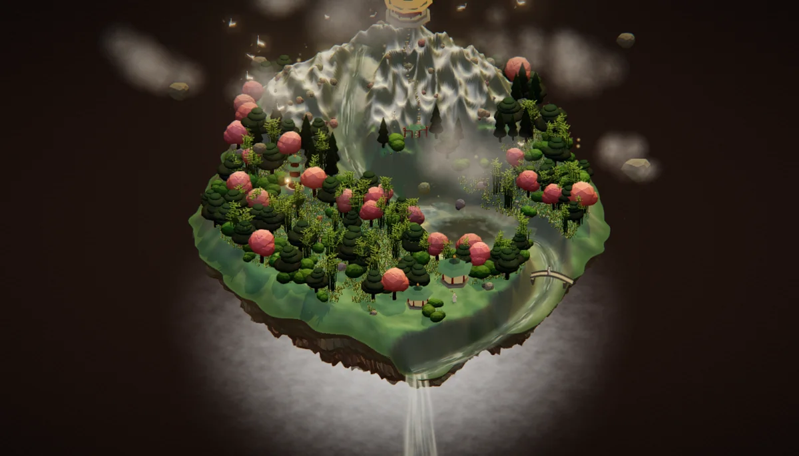
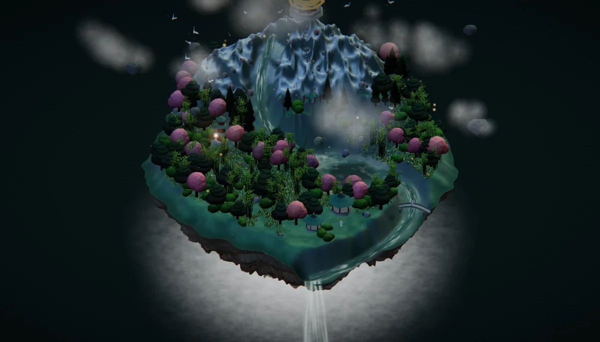
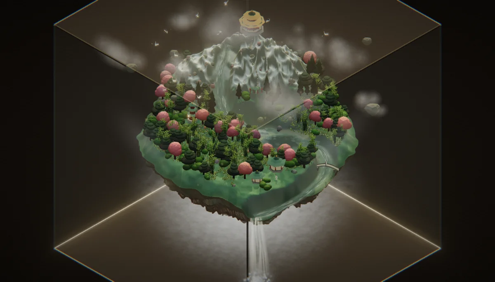
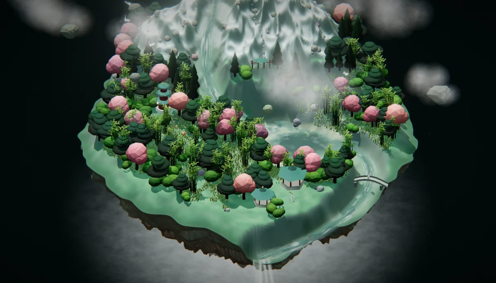

# 技术细节

README 只留了"是什么 / 怎么跑"。实现细节、验收方法和已知取舍都在这里。

| 黎明 | 黄昏 | 夜 |
|---|---|---|
|  |  |  |

| 玻璃立方体(按 `G`) | 微距细节 |
|---|---|
|  |  |

## 里面有什么

| 层 | 内容 |
|---|---|
| 地形 | 极坐标高度场 132 环 × 320 段,2 遍 `[1,2,1]` 平滑;雪线、草坡、岩壁、河床、沙滩全按坡度与海拔**烘焙进顶点色** |
| 水 | 湖面 / 河道 / 双瀑,自定义 shader;半分辨率平面反射 + 流向条纹 |
| 建筑 | 六角亭 ×2、三层塔、拱桥、雪顶金瓦仙宫、山门牌坊、46 级盘山石阶、7 对石灯笼、5 块浮石 |
| 植被 | 松 / 桃 / 杉 / 灌木 / 竹 / 草(约 1.1 万株,InstancedMesh)/ 岩石 / 野花 |
| 动物 | 鹿、兔、仙鹤;带避障,会绕开建筑 |
| 仙人 | 4 位白袍道人:桥面、亭前、雪顶仙宫、山门 |
| 大气 | 云朵、薄雾、光柱、浮尘、萤火、飞鸟环 |
| 昼夜 | 7 组关键帧调色板 —— 黎明青、正午玉、黄昏金、夜墨 |

「尺子」是统一的:仙人 0.20 单位 ≈ 1.7 m,由此推出亭 0.70、塔/仙宫 0.90、松 0.46~0.80、鹿 0.15、兔 0.06、草 0.02~0.04。

## 为什么是单文件

`file://` 下 ES module 会被 CORS 拦掉,所以 esbuild 先把 `src/main.js` 打成 IIFE,
再把整个 bundle 内联进 `index.html`。代价是成品 640 KB,收益是"双击就能开、断网也能开"。

three.js r169 与用到的 addons 直接 vendored 在 `vendor/three/(three.module.js|addons…)`,
构建期不下载任何东西。

主相机是正交等距(`OrthographicCamera`):边长 10 的立方体投影高 16.3,
视锥高取 17.6 才能把它完整装进画面。

## 目录

```
src/
  main.js            入口:装配、灯光、昼夜、URL 参数、仙人视角
  postfx.js          后处理链
  ui.js              HUD
  core/palette.js    7 组昼夜调色关键帧
  scene/
    island.js        地形高度场 + 岩底 + 河道下切(含 θ=0 接缝焊接)
    water.js         湖 / 河 / 瀑 三套水面 shader
    architecture.js  亭塔桥宫门阶灯
    flora.js         树 / 竹 / 草 / 岩 / 花
    fauna.js         鹿 / 兔 / 鹤 + 避障
    immortal.js      仙人
    atmos.js         云 / 雾 / 光柱 / 尘 / 萤火
    glass.js         玻璃立方体
    sky.js           深空天穹 + 星点
  lib/               合并几何、噪声、程序化贴图、平面反射
vendor/three/        three.js r169 + 用到的 addons
tools/               验收脚本
build.mjs            打包 → index.html
```

## URL 参数(截图 / 排查用)

`?t=0.3` 固定时刻 · `&freeze=1` 冻结时间与自转 · `&zoom=2` 推近 · `&glass=0|phys` 玻璃 ·
`&pov=1` 直接进仙人视角 · `&ui=0` 隐藏 HUD · `&dpr=1` 像素比 · `&debug=1` 显示 drawcall ·
`&post=0` 关后处理 · `&only=water` / `&hide=glass,mist` 只显示 / 隐藏若干层。

## 验收脚本(可选,需要真 GPU)

`tools/*.py` 用 Playwright 连一个真实 GPU 的 Chrome(`--remote-debugging-port=9333`),
做的是**量的验收**而不是肉眼对着看:

| 脚本 | 量什么 |
|---|---|
| `gpu.py` | 逐时刻截图 + 帧率 + drawcalls |
| `occl.py` | 每个仙人站位的主机位可见率、绕岛 8 方位角、候选站位打分 |
| `povcheck.py` | 仙人视角的俯仰角、视野里岛体占比、`Esc` 是否退回主相机 |
| `closeup.py` | 把相机推到每个站位拍近景(正交相机靠 zoom,不是推 position) |
| `blurcheck.py` | 移轴开/关的逐区域锐度保留率(要先把胶片颗粒关掉,否则测到的是噪声) |
| `probe.py` | 镜头推到任意世界坐标,按名字关网格,定位"这道缝是谁" |

```bash
pip install playwright && playwright install chromium
python3 tools/gpu.py --times 0.30 0.72 0.95 --prefix shot
```

## 已知取舍

- 树与竹**没有碰撞体**:鹿兔会从树干里穿过(建筑有避障)。
- 移动端 / 核显未测;494k 三角形在低端设备上大概需要一档降级(减草、关阴影)。
- 移轴默认关:它会把画面上/下沿糊掉(雪山顶只剩 49% 锐度),想要微缩味按 `F` 打开。
